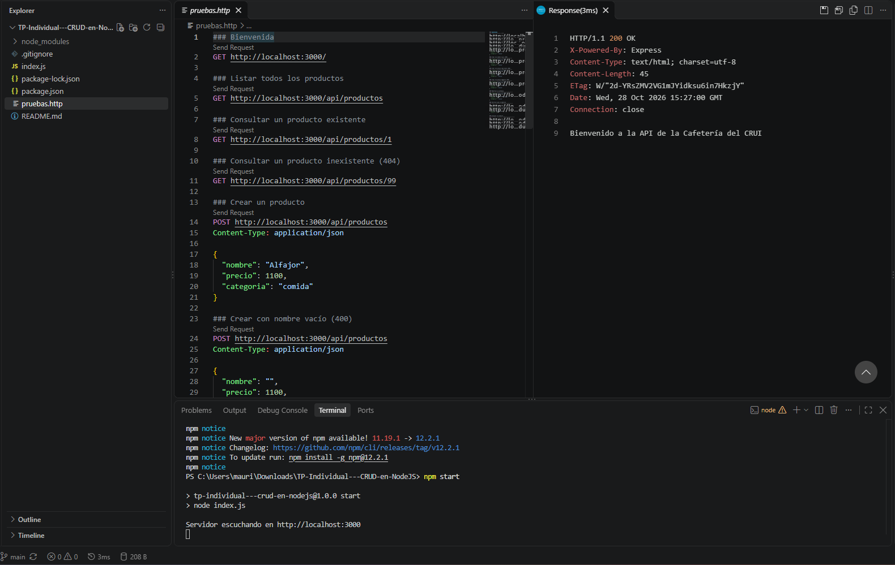
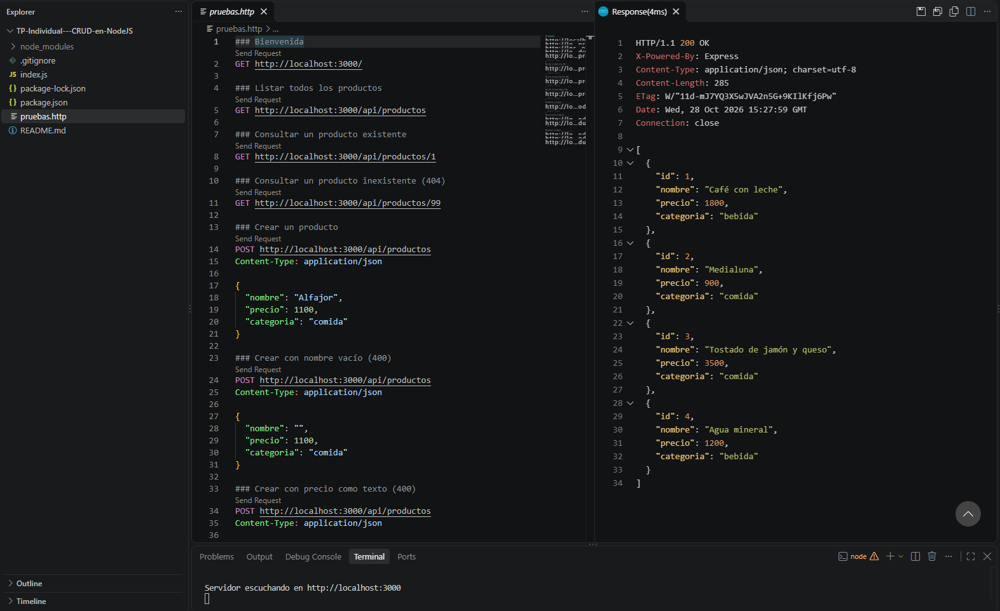
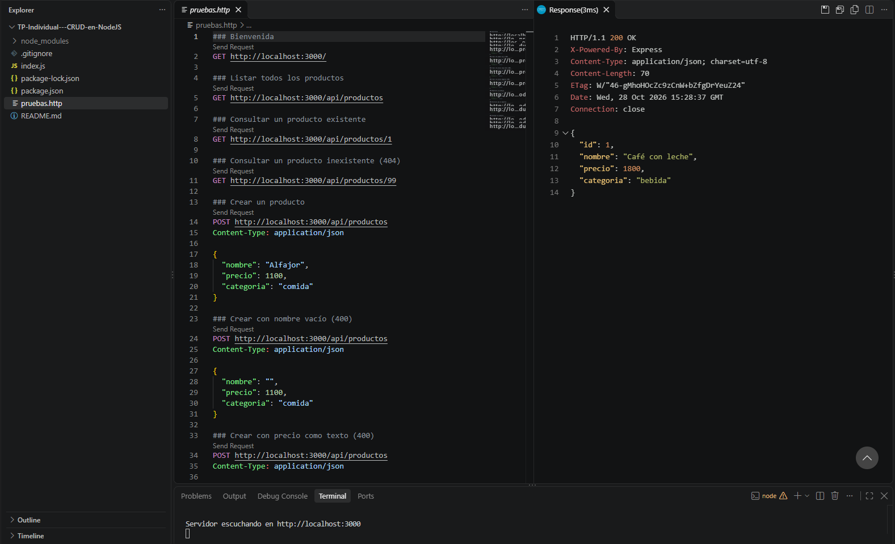
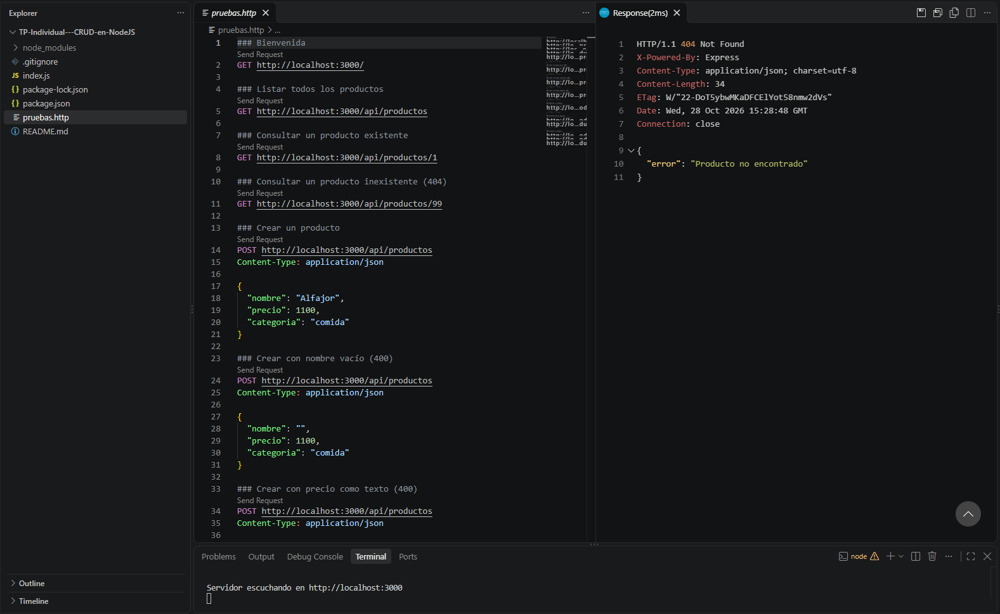
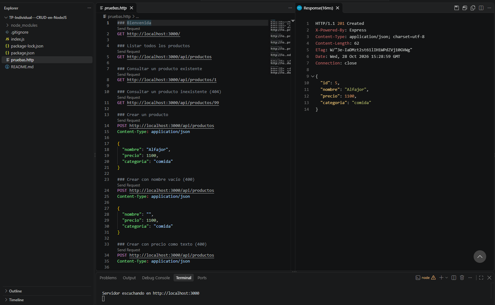
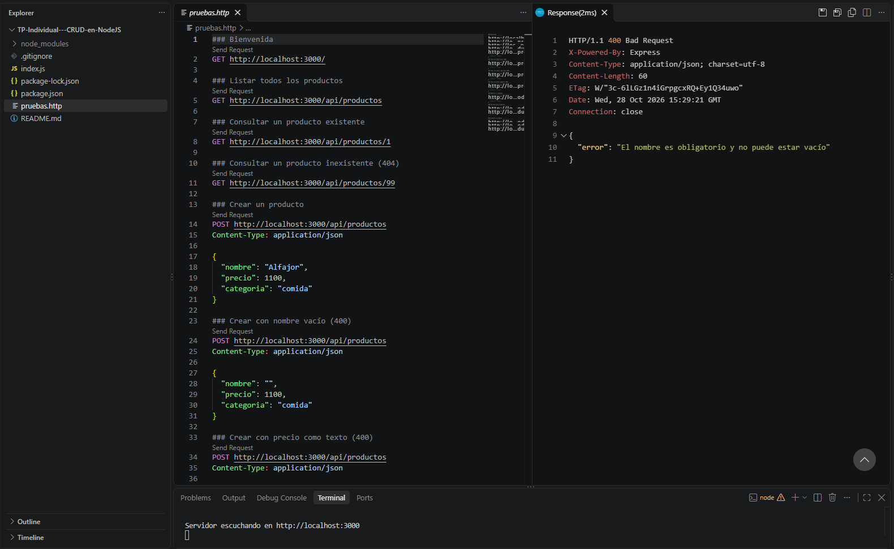
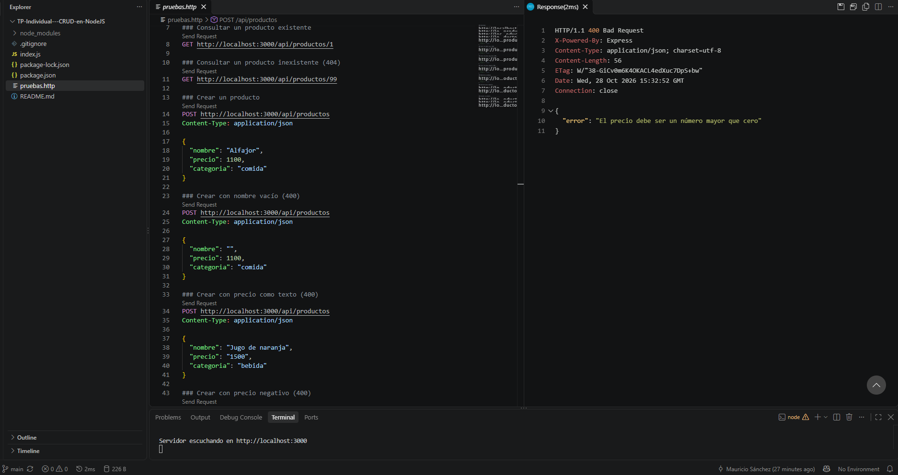
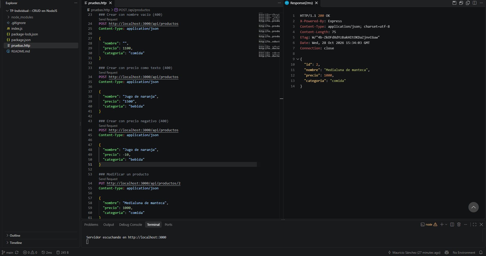
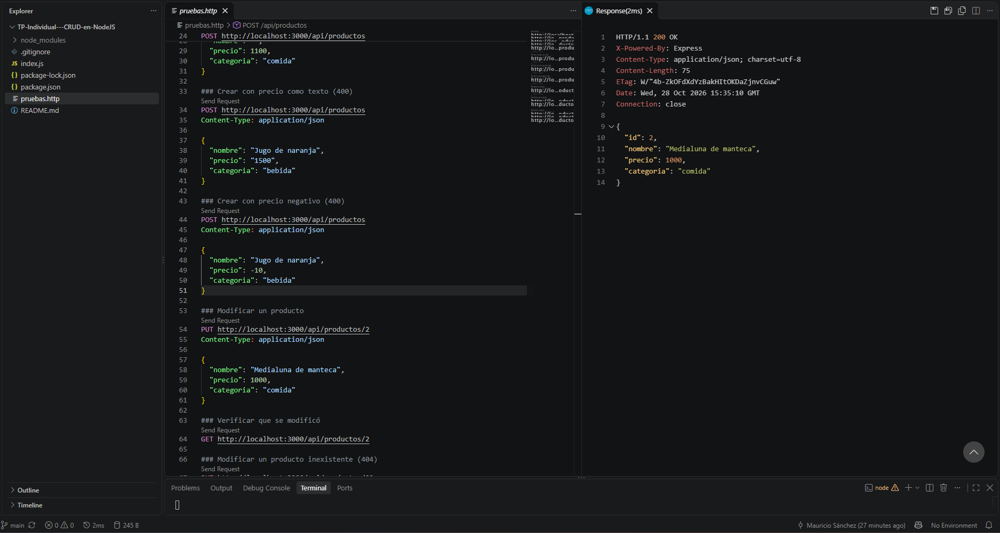
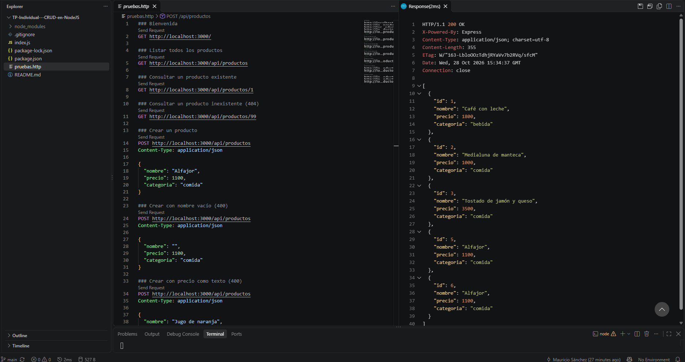

# Mini API de la Cafetería del CRUI

API REST hecha con Node.js y Express para consultar y administrar los productos del menú de la cafetería. Los datos se guardan en un array en memoria, así que los cambios se mantienen solo mientras el servidor está en ejecución.

## Requisitos

- [Node.js](https://nodejs.org/) (versión 18 o superior)

## Instalación

Clonar el repositorio e instalar las dependencias:

```bash
git clone https://github.com/MauriiS/TP-Individual---CRUD-en-NodeJS.git
cd TP-Individual---CRUD-en-NodeJS
npm install
```

## Ejecución

```bash
npm start
```

El servidor queda escuchando en `http://localhost:3000`.

## Rutas

| Método | Ruta                 | Descripción                       | Respuestas      |
|--------|----------------------|-----------------------------------|-----------------|
| GET    | `/`                  | Mensaje de bienvenida             | 200             |
| GET    | `/api/productos`     | Lista todos los productos         | 200             |
| GET    | `/api/productos/:id` | Busca un producto por su ID       | 200, 404        |
| POST   | `/api/productos`     | Crea un producto nuevo            | 201, 400        |
| PUT    | `/api/productos/:id` | Modifica un producto existente    | 200, 400, 404   |
| DELETE | `/api/productos/:id` | Elimina un producto               | 200, 404        |

Ejemplo de body para POST y PUT:

```json
{
  "nombre": "Alfajor",
  "precio": 1100,
  "categoria": "comida"
}
```

### Validaciones

- `nombre` es obligatorio y no puede estar vacío.
- `precio` debe ser un número mayor que cero (no se aceptan precios como texto, por ejemplo `"1500"`).
- Si los datos son inválidos se responde con **400**; si el producto no existe, con **404**.
- El `id` de los productos nuevos lo genera el servidor.

## Pruebas

El archivo `pruebas.http` tiene todas las peticiones de prueba y se puede ejecutar con la extensión REST Client de VS Code.

### Capturas

**GET /** — mensaje de bienvenida (200)



**GET /api/productos** — listado de productos (200)



**GET /api/productos/1** — producto existente (200)



**GET /api/productos/99** — producto inexistente (404)



**POST /api/productos** — crear producto (201)



**POST /api/productos** — nombre vacío (400)



**POST /api/productos** — precio enviado como texto (400)



**PUT /api/productos/2** — modificar producto (200)



**GET /api/productos/2** — se verifica que el producto cambió (200)



**GET /api/productos** — el listado refleja los productos creados, el modificado y el eliminado (200)


